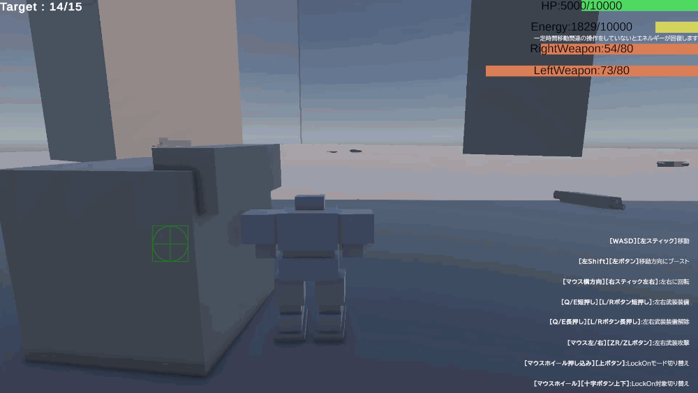

# Project:3DRobotAction

卒業制作の3Dロボットアクションのコアループを作成。
今後様々な要素を追加することを前提に、**拡張性・可読性**を重視して設計・コーディングを行いました。

## 本作品の開発について
本プロジェクトはコアループの完成を目標とし見た目や効果音よりもまずプレイできる状態にすることを重視して制作してきました。
ですが、プレイヤーと銃の見た目に関しては別プロジェクトにて自身で作成した簡易的なモデルを流用しています。

## コアループの短いデモ映像

## 開発環境
- **Engine**: Unity6000.3.17f1
- **Graphics API**: Direct3D 11 (動作安定化のため固定)
- **Render Pipeline**: Universal Render Pipeline (URP)
- **Target Platform**: Windows 11
- **Package**: Chinemachine(プレイヤー追従カメラ)

## 起動方法
1. 本リポジトリを`git clone`またはダウンロードします。
2. Unity 6000.3.17f1 でプロジェクトを開きます。
3. `Assets/RobotAction/Scenes/Title.unity`を開きPlayボタンを押すことでコアループ(武器選択=>敵の撃破)をプレイできます。

## 操作方法

※ゲーム内のUI・ガイド表示でも同様の操作方法を確認いただけます。

### バトル関連のアクション
|操作内容|キーボード+マウス|ゲームパッド|
|:---|:---|:---|
|移動|WASD|左スティック|
|移動方向にブースト(長押しで加速を持続)|左Shift|前面ボタン: 左|
|浮遊|Spaceキー|前面ボタン:下|
|左右に回転(視点移動を兼ねています)|マウス横移動|右スティック左右|
|左右に武器を装備(未装備時のみ)|Q/E短押し|L/Rボタン短押し|
|左右の武器を装備解除|Q/E長押し|L/Rボタン長押し|
|左右の武器を使用|マウス左/右クリック|ZL/ZRボタン|
|LockOn切り替え|マウスホイール押し込み|前面ボタン: 上|
|LockOn対象の変更|マウスホイール上下|十字ボタン上下|

※「前面ボタン（上/下/左/右）」は、ゲームパッド上の右手側にある4つのメインボタン (Switch: X/B/Y/A、PS: △/×/□/○、Xbox: Y/A/X/B) の物理配置(方向)に対応しています。

>**補足：**
>サードパーティ製のコントローラーをお使いの場合上記のボタンと実際のボタン操作にずれが生じる可能性があります。

## 技術的な工夫点

### 1. アーキテクチャと関心事の分離
- **MVP設計を用いたUIの描画**
  UIの描画処理とロジックを分離し、表示と状態管理の依存度を下げています。
- **asmdefを用いたコンパイル速度の効率化**
  機能ごとにアセンブリを分け、コンパイル時間の削減と依存関係の単方向化を徹底しています。
  
### 2. Class:PlayerControllerの肥大化軽減
- **Playerの動作の切り出し**
  Playerの動作を Pure C# クラス(`MonoBehaviour`非依存)の`Mover`,`LookController`等に分割し、
  PlayerControllerはそれらにData(SO)などの必要な変数をコンストラクタで注入する構成にしています。
  >**補足(上記のPure C# クラスについて):**
  >`MonoBehaviour`には依存していないものの、`Transform`や`Rigidbody`を扱うためUnityEngineには依存しています。

### 3. Gitの運用方針
- **アトミックコミットの徹底**
  Gitのメリットを活かすために1つのコミットにつき1つの変更のみを含め、変更履歴の追跡を容易にしています。
- **Conventional Commitsに基づくコミットメッセージ**
  コミットメッセージには`feat:`,`refactor:`,`fix:`,`chore:`などのプレフィックスを明記しています。
- **Scene変更時の原則単体コミット**
  Sceneファイルはマージコンフリクトが発生しやすく、他の変更と混在させてしまうとマージ解消が困難になってしまうため、原則として単体でコミットしています。
  >**補足(例外的に関連の変更とまとめてコミットするケース)**
  >Sceneへの日本語テキストのUI追加に伴い、フォントアセットに文字を追加する場合はまとめてコミットします。
  >これらを個別にコミットした場合`Revert`時に文字化けが発生してしまいコミット単体で正常に動作しなくなる(アトミック性の原則に違反)するためです。
  
>**補足 (履歴の再構築について):**
>今回`git rebase`を用いて履歴を1本線になるように整え、`--force-with-lease`で強制プッシュしていますが
>この行為が他のメンバーの作業履歴を破壊するためチーム製作で行ってはいけない事であると理解しています。
>今回のプロジェクトは個人制作であり、なおかつ第三者に確認してもらうため履歴の可読性を優先しました。
 
## 設計に関する補足 (トレードオフと判断理由)
- **`IPart`インターフェースの設計理由**
  パーツであることを示すインターフェース`IPart`を実装しているのが`IWeaponPart`のみとなっていますが今後脚部パーツなどの追加の予定があるためオーバーエンジニアリングにはなっておりません。
- **UIにおけるPresenterの簡略化**
本READMEの最初に`MVP設計を用いたUIの描画`と記述しましたがPresenterがただの情報の横流しになっている場合は内部処理をカプセル化するメリットがなくコードを無駄に追うだけになることを避けるためHudView内のメソッドを直接呼ぶ設計になっています。
- **SOにおけるインターフェース設計の使い分け**
  - `PlayerMoverData` 等のSOにおいて、今後モック化テスト等を行う見通しがないため、あえて`IPlayerMoverData`　などのインターフェースを挟まず SOを直接参照させています。
  - 一方で`WeaponPartData`(SO)の情報はUI層でも使用するため`IWeaponPartData`というインターフェースを用いて`UI`と`Gameplay`アセンブリが`Core`内の抽象に依存する設計となっています。
